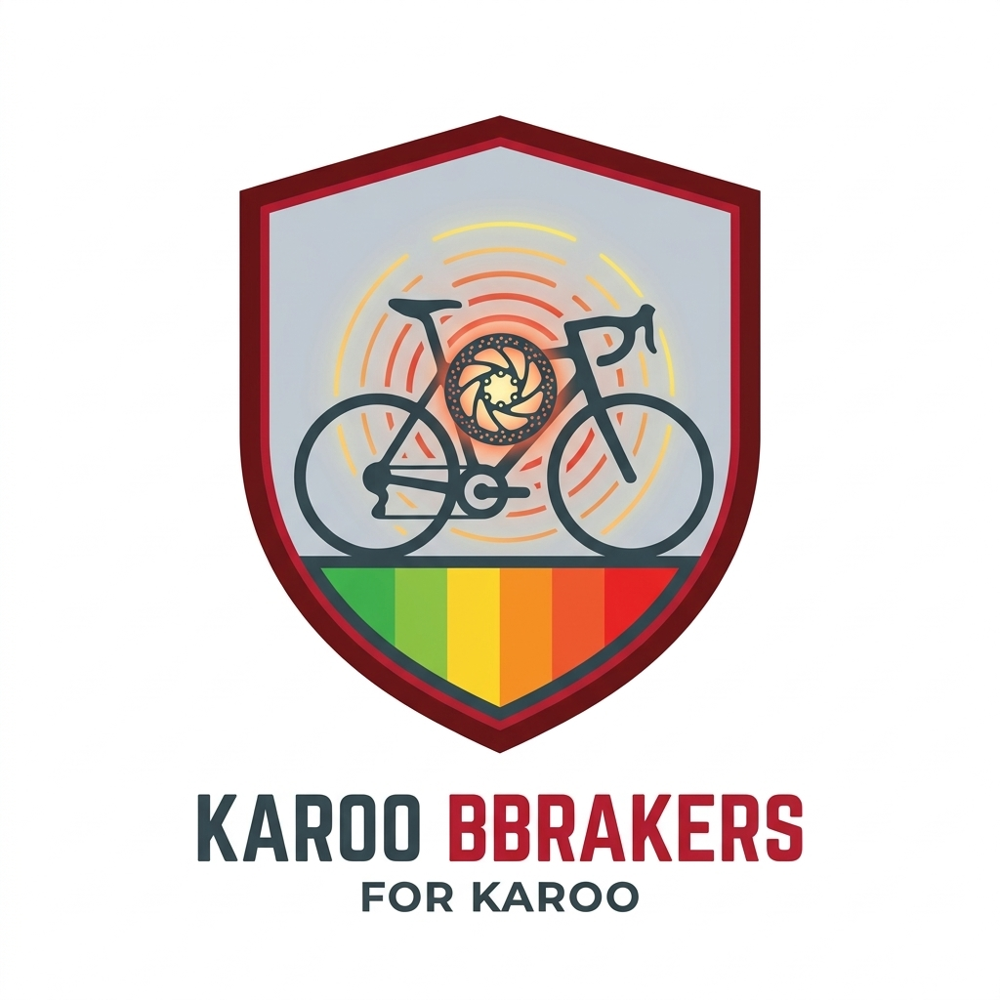

<p align="center">
  
</p>

# Karoo BBrakers
### WorldTour-Grade Braking Telemetry, Dynamic Load Transfer, Kamm Friction Circle & Dual Thermal Safety Monitor for Hammerhead Karoo 2 & Karoo 3

<p align="center">
  <b>Language:</b> 
  <a href="README.md"><b>English</b></a> | 
  <a href="README_ES.md"><b>Español</b></a> | 
  <a href="README_DE.md"><b>Deutsch</b></a> | 
  <a href="README_FR.md"><b>Français</b></a> | 
  <a href="README_IT.md"><b>Italiano</b></a> | 
  <a href="README_PT.md"><b>Português</b></a>
</p>

---

## Overview
**Karoo BBrakers** is a comprehensive cycling braking telemetry, inertial dynamics, and active safety extension developed specifically for the **Hammerhead Karoo** platform (Karoo 2 and Karoo 3).

Modern cycling performance analysis has focused almost exclusively on power meters, heart rate, and cadence. Yet, in competitive road racing, gravel descents, and mountain biking, **races are won and crashes avoided through braking efficiency, late-apex trail braking, and thermal management**. Karoo BBrakers turns your Hammerhead cycling computer into a telemetry cockpit previously seen only in Formula 1 and MotoGP.

---

## Core Physics & WorldTour Engineering

### 1. Dynamic Inertial Deceleration (50 Hz Hardware Sampling)
- Utilizes the Karoo's internal hardware IMU (`Sensor.TYPE_LINEAR_ACCELERATION` and `Sensor.TYPE_ACCELEROMETER`) running at **50 Hz (20 ms updates)**.
- **Continuous Decoupled Calculation**: Gravity pitch tilt and road grade are isolated using continuous complementary filters. Deceleration is measured directly in physical units ($\text{m/s}^2$ or $G$-Force) with instant responsiveness.
- **Aerodynamic & Rolling Resistance Baseline Filtering**: Natural coasting drag caused by wind resistance ($F_{aero} = \frac{1}{2}\rho C_d A v^2$) and tire rolling friction ($C_{rr}$) is mathematically decoupled so that coasting on flats is never falsely detected as braking.

### 2. Dynamic Load Transfer & Front/Rear Bias
- When a cyclist decelerates, inertia shifts weight forward onto the front tire contact patch:
  $$\Delta W = \frac{m \cdot a \cdot h_{CG}}{L_{wheelbase}}$$
- On steep downhill descents, front wheel normal load can surge up to **85%**. Karoo BBrakers computes real-time **Front vs Rear braking distribution**, helping riders optimize lever modulation and avoid rear-wheel lockups.

### 3. Kamm’s Friction Circle & Washout Prevention
- A tire possesses a finite vector adhesion limit:
  $$F_{total} = \sqrt{F_{braking}^2 + F_{cornering}^2} \le \mu \cdot N$$
- Combining high braking force with deep cornering lean ($\theta_{lean}$) dramatically increases the risk of catastrophic front-wheel washouts.
- Karoo BBrakers continuously calculates your **Grip Margin %** in real time, alerting riders before exceeding tire slip limits.

### 4. Dual Thermodynamic Heat & Carbon Rim Fade Monitor
- **Differential Rotor Cooling**: Front calipers receive clean, high-velocity laminar airflow ($h_{front} \propto v^{0.8}$), while rear calipers are shielded in turbulent chainstay wash ($h_{rear} \approx 0.65 \cdot h_{front}$).
- **Material Safety Limits**:
  - **Disc Brakes**: Safe up to 350°C.
  - **Rim Brakes (Aluminium)**: Safe up to 150°C.
  - **Rim Brakes (Carbon Wheel Track)**: High warning at 145°C, critical delamination alarm at **180°C** to prevent tire blowouts.

### 5. Involuntary Brake Drag Detection (Wasted Watts)
- Continuously identifies stuck caliper pistons, bent rotors, or pad rubbing while pedaling.
- Calculates instantaneous **Wasted Watts** ($P = F_{rub} \cdot v$) so riders can immediately detect parasitic power loss.

### 6. Peloton Feathering Mode
- In fast group pacelines, cyclists subtly feather the rear brake to trim distance without stopping.
- Karoo BBrakers isolates micro-feathering events (0.2–1.2 $\text{m/s}^2$), displaying a distinctive purple status badge without triggering hard braking alarms.

---

## Complete Data Fields Catalog (10 Karoo Types)

Karoo BBrakers registers 10 native DataTypes in Karoo OS (`extension_info.xml`):

| Type ID | Display Name (English) | Format | Description |
|---|---|---|---|
| `current_decel` | **Braking Deceleration** | Numeric | Instantaneous deceleration in $\text{m/s}^2$, $G$-Force, or $\text{ft/s}^2$. |
| `braking_power` | **Braking Power** | Numeric | Kinetic power dissipated by the brakes in Watts ($W$). |
| `max_decel` | **Max Decel G** | Numeric | Maximum peak deceleration recorded during the ride. |
| `brake_events` | **Brake Events** | Numeric | Total count of distinct braking and feathering actions. |
| `brake_energy` | **Energy Dissipated** | Numeric | Total cumulative energy absorbed by brakes in kilojoules ($\text{kJ}$). |
| `pad_wear` | **Pad Wear Index** | Numeric | Estimated wear score based on friction energy and compound type. |
| `brake_temperature`| **Brake Temperature** | Numeric | Real-time estimated rotor/rim temperature in °C or °F. |
| `graphical_brake` | **Brake Gauge (Graphical)**| Graphic | 5-segment color gauge (White to Yellow to Orange to Red). |
| `graphical_thermal`| **Thermal & Fade Monitor** | Graphic | Dual front/rear temperatures, safety zones, and material limits. |
| `graphical_cockpit`| **Brake Cockpit HUD** | Graphic | Comprehensive glance HUD with gauge, power, temp, lean, and grip. |

---

## In-Ride Visual Color Spectrum
The graphical widgets use high-contrast color indexing for instant legibility at 40–70 km/h:
- **White** ($< 1.0\text{ m/s}^2$): Initial pad contact / subtle feathering.
- **Pale Yellow** ($1.0 - 2.0\text{ m/s}^2$): Light modulation / distance trimming.
- **Pure Yellow** ($2.0 - 3.2\text{ m/s}^2$): Standard corner entry braking.
- **Orange** ($3.2 - 4.5\text{ m/s}^2$): Firm deceleration on steep descents.
- **Red** ($> 4.5\text{ m/s}^2$): Emergency hard braking / panic stop alert.
- **Violet**: Peloton feathering active in paceline.
- **Green**: Rotor temperature in optimal safety zone ($< 80^\circ\text{C}$).

---

## FIT Developer Data Fields & Post-Ride Analysis
During recorded rides, Karoo BBrakers injects standard FIT Developer Fields at 1 Hz:
- `BrakingDeceleration` ($\text{m/s}^2$)
- `BrakingPower` ($\text{Watts}$)
- `IsBraking` ($0/1\text{ flag}$)
- `BrakeTemperature` ($^\circ\text{C}$)
- Summary Session fields: Total Events, Peak G, Absorbed kJ, and Pad Wear Score.

Compatible with **Strava**, **Intervals.icu**, **GoldenCheetah**, and **WKO5**.

---

## Installation & OTA Updates

### Option 1: Direct Manifest Installation on Karoo
1. Copy this Manifest URL:
   ```
   https://raw.githubusercontent.com/DAVOE75/KarooBBrakers/main/manifest.json
   ```
2. On your Hammerhead Karoo, open **Settings -> Extensions -> Add Extension**.
3. Paste the URL. Karoo OS will install Karoo BBrakers automatically and notify you whenever an update is released.

### Option 2: Sideload via ADB
```bash
adb install -r karoobbrakers.apk
```

---

## Developer & Credits
- **Author**: hesiox ([DAVOE75](https://github.com/DAVOE75))
- **Target Hardware**: Hammerhead Karoo 2 / Karoo 3 (Android 8.1 - 12+)
- **SDK**: Hammerhead Karoo Extension SDK (`io.hammerhead.karooext`)
- **License**: MIT License
