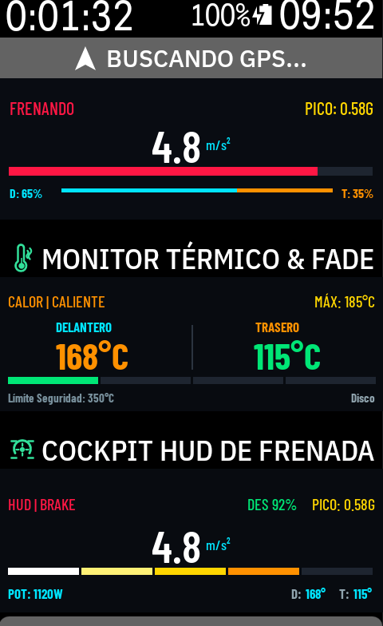
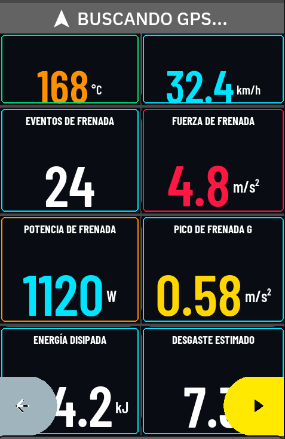
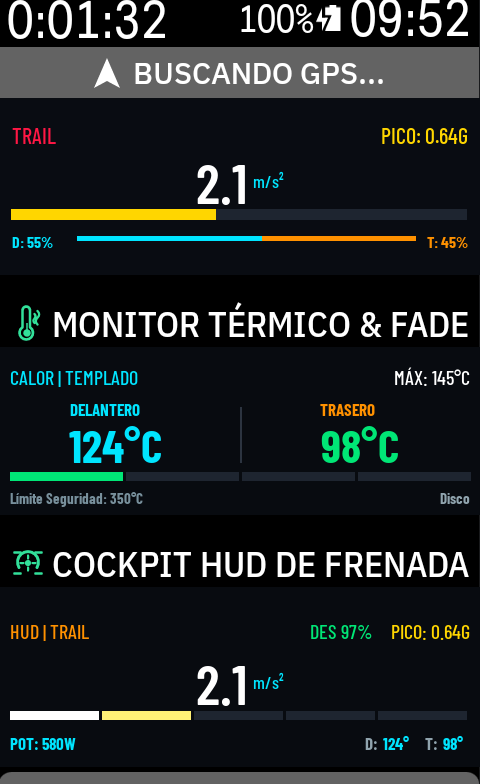

<p align="center">
  
</p>

# Karoo BBrakers
### Télémétrie de Freinage WorldTour PRO, Radar de Virage & Vitesse au Point de Corde, Limite d'Adhérence de Kamm, Énergie Métabolique & Fluidité en Peloton (PEI) pour Hammerhead Karoo 2 & Karoo 3

<p align="center">
  <b>Langue / Language:</b> 
  <a href="README.md"><b>English</b></a> | 
  <a href="README_ES.md"><b>Español</b></a> | 
  <a href="README_DE.md"><b>Deutsch</b></a> | 
  <a href="README_FR.md"><b>Français</b></a> | 
  <a href="README_IT.md"><b>Italiano</b></a> | 
  <a href="README_PT.md"><b>Português</b></a>
</p>

<p align="center">
  <a href="https://github.com/DAVOE75/KarooBBrakers/releases/latest"></a>
  <a href="https://github.com/DAVOE75/KarooBBrakers/releases"></a>
  
  <a href="https://github.com/DAVOE75/KarooBBrakers/blob/main/LICENSE"></a>
  <a href="https://buymeacoffee.com/hesiox"></a>
</p>

---

## Présentation Générale
**Karoo BBrakers** est une extension complète de télémétrie de freinage, de dynamique inertielle, de sécurité prédictive et d'intelligence de course conçue spécialement pour l'écosystème **Hammerhead Karoo** (Karoo 2 et Karoo 3).

L'analyse de performance cycliste moderne s'est longtemps concentrée sur les capteurs de puissance, la fréquence cardiaque et la cadence. Pourtant, en compétition sur route, en descente de col alpin, en gravel et en VTT, **les victoires se forgent et les chutes s'évitent au freinage** : grâce au trail-braking jusqu'au point de corde, à la vitesse de sortie de virage et à la gestion thermique des disques et plaquettes. Karoo BBrakers transforme votre compteur en véritable cockpit de télémétrie WorldTour.

---

## Aperçus du Cockpit et de la Télémétrie en Course

<p align="center">
  
  
  
</p>

<p align="center">
  <em>À gauche : HUD Cockpit en direct et Moniteur Thermique double rotor lors d'une forte décélération en épingle | Au centre : Grille de compétition à 8 champs avec bordures réactives par couleur | À droite : Détection pro du Trail-Braking et Score d'Efficacité en Descente WorldTour (DES 97%).</em>
</p>

---

## Physique, Algorithmes & Ingénierie WorldTour

### 1. Verrouillage à l'Arrêt & Immunité aux Faux Positifs (< 4 km/h)
- Sans micro-interrupteurs physiques sur les leviers ni capteurs hydrauliques, un test sur table ou un arrêt au feu rouge ne doit jamais enregistrer de freinage.
- Lorsque la vitesse GPS ou capteur de roue est inférieure à $1.11\text{ m/s}$ ($4.0\text{ km/h}$), tous les vecteurs de décélération sont strictement ramenés à $0.00\text{ m/s}^2$. Le système reste stable en état **ARMÉ** et la détection instantanée s'enclenche dès que le vélo commence à rouler.

### 2. Découplage Gravitationnel en Montée
- Dans les pentes raides, la gravité tire l'accéléromètre interne vers l'arrière le long de l'axe longitudinal ($g \cdot \sin(\theta)$).
- Karoo BBrakers calcule l'angle d'inclinaison instantané $\theta = \arcsin\left(\frac{-g_y}{9.80665}\right)$ et soustrait la composante gravitationnelle :
  $$a_{\text{freinage, net}} = a_{\text{mesuré, y}} - \max(0, g \cdot \sin(\theta))$$
- Les pentes raides de $15\% - 25\%$ ne déclenchent ainsi jamais de fausse décélération.

### 3. Radar de Virage & Maintien de Vitesse au Point de Corde (0–100%)
- Enregistre la vitesse d'entrée ($v_{\text{entrée}}$), la vitesse minimale au point de corde ($v_{\text{apex}}$) et la réaccélération en sortie ($\Delta v_{\text{sortie}}$).
- Calcule le **Pourcentage de Rétention de Vitesse au Point de Corde** :
  $$\text{Rétention Apex} = \left(\frac{v_{\text{apex}}}{v_{\text{entrée}}}\right) \cdot 100\%$$
- Les meilleurs descendeurs professionnels visent un maintien supérieur à $75\%$ en courbe rapide afin de conserver leur élan.

### 4. Alertes Prédictives de Freinage Avant Virage
- En fonction du rayon de courbure du virage à venir et de la vitesse courante, calcule la distance d'arrêt requise :
  $$d_{\text{arrêt}} = \frac{v_{\text{actuelle}}^2 - v_{\text{sécurité}}^2}{2 \cdot a_{\text{sécurité}}}$$
- Émet un signal sonore et une alerte `InRideAlert` sur l'écran du Karoo avec la distance d'anticipation recommandée.

### 5. Cercle de Friction de Kamm & Alarme de Perte d'Adhérence
- L'adhérence totale du pneu est physiquement limitée par :
  $$F_{\text{total}} = \sqrt{F_{\text{freinage}}^2 + F_{\text{virage}}^2} \le \mu \cdot N$$
- Sur route mouillée (`WET_ROAD`, $\mu \approx 0.45$), freiner fort avec le vélo incliné entraîne un décrochage brutal de la roue avant (*washout*).
- Karoo BBrakers surveille en continu la **Marge d'Adhérence %** et déclenche une alarme d'urgence si la limite est atteinte.

### 6. Énergie Métabolique Gaspillée (kJ & kcal)
- Tout freinage détruit de l'énergie cinétique mécanique ($\Delta E = \frac{1}{2} m (v_1^2 - v_2^2)$).
- Selon l'efficacité musculaire brute humaine ($\eta \approx 21.5\%$), relancer pour récupérer cette vitesse exige de brûler près de 5 fois plus de glycogène métabolique :
  $$E_{\text{métabolique}} = \frac{\Delta E_{\text{cinétique}}}{0.215}$$
- Comptabilise le total des kilojoules et kilocalories dépensés inutilement au freinage pendant la sortie.

### 7. Indice de Fluidité en Peloton (PEI 0–100%)
- Des coups de frein brutaux en tête de groupe créent des ondes de choc en accordéon vers l'arrière, obligeant les poursuivants à des sprints à 800W.
- Sur une fenêtre glissante de 60 secondes, le PEI note la fluidité de 0 à 100% pour optimiser l'économie d'énergie dans l'aspiration.

### 8. Score d'Efficacité en Descente (DES 0–100%)
- La descente alpine exige des freinages courts et appuyés par impulsions avant le virage, puis un relâchement complet en ligne droite pour refroidir le disque par convection.
- Frotter continuellement les freins provoque la vitrification thermique des plaquettes.
- L'algorithme DES évalue votre technique de 0 à 100%.

### 9. Répartition Dynamique de Charge (Avant/Arrière)
- Lors de la décélération, l'inertie transfère la masse sur le pneu avant :
  $$\Delta W = \frac{m \cdot a \cdot h_{\text{CG}}}{L_{\text{empattement}}}$$
- En descente raide, jusqu'à **85% de la charge** repose sur la roue avant. Karoo BBrakers calcule la répartition en temps réel.

### 10. Odomètre Digital d'Entretien des Plaquettes
- Comptabilise l'énergie totale absorbée par les plaquettes en kilojoules ($\text{kJ}$) :
  - **Organique / Résine** : ~2500 kJ de capacité nominale.
  - **Semi-Métallique** : ~4500 kJ de capacité nominale.
  - **Frittée / Métallique** : ~7000 kJ de capacité nominale.
- Affiche la **Vie Restante des Plaquettes %** avec réinitialisation d'un simple geste.

### 11. Thermodynamique Duale & Alerte de Glaçage
- **Refroidissement Différentiel** : L'étrier avant bénéficie d'un flux d'air laminaire propre, tandis que l'arrière est masqué dans l'air turbulent des haubans.
- **Seuils de Sécurité** :
  - **Freins à disque** : Sûr jusqu'à 350°C.
  - **Patins (Jante aluminium)** : Sûr jusqu'à 150°C.
  - **Patins (Jante carbone)** : Alerte préventive à 145°C, alarme critique de délamination à **180°C**.

### 12. Détection de Frottement Parasite (Watts Perdus / Wasted Watts)
- Détecte en continu les pistons grippés, disques voilés ou plaquettes qui frottent pendant le pédalage.
- Calcule en temps réel les **Watts Perdus** ($P = F_{\text{frottement}} \cdot v$).

---

## Catalogue Complet des Champs de Données (17 Types Natifs)

Karoo BBrakers enregistre 17 types de données natifs dans Karoo OS (`extension_info.xml`) :

| Type ID | Nom Affiché (Français) | Format | Description |
|---|---|---|---|
| `current_decel` | **Décélération de Freinage** | Numérique | Décélération instantanée en $\text{m/s}^2$, Force $G$ ou $\text{ft/s}^2$. |
| `braking_power` | **Puissance de Freinage** | Numérique | Puissance cinétique dissipée par les freins en Watts ($W$). |
| `max_decel` | **Pic de Décélération G** | Numérique | Décélération maximale enregistrée lors de la sortie. |
| `brake_events` | **Événements de Freinage** | Numérique | Compteur total des actions de freinage et léchages. |
| `brake_energy` | **Énergie Dissipée** | Numérique | Énergie cinétique totale absorbée par les freins en kilojoules ($\text{kJ}$). |
| `pad_wear` | **Indice d'Usure Plaquettes** | Numérique | Usure estimée selon l'énergie absorbée et le composé. |
| `pad_life` | **Vie Restante Plaquettes** | Numérique | Pourcentage estimé de vie restante selon les kJ cumulés. |
| `descent_efficiency` | **Efficacité en Descente (DES)**| Numérique | Score WorldTour (0–100%) récompensant les freinages par impulsions. |
| `wasted_watts` | **Watts Perdus (Frottement)** | Numérique | Puissance parasite dissipée par frottement involontaire en Watts. |
| `grip_margin` | **Marge d'Adhérence Virage** | Numérique | Marge de sécurité du cercle de Kamm avant décrochage du pneu en %. |
| `brake_temperature`| **Température des Freins** | Numérique | Température estimée en temps réel du disque/jante en °C ou °F. |
| `corner_radar` | **Radar de Virage & Corde** | Numérique | Vitesse d'entrée, maintien au point de corde et relance en sortie. |
| `metabolic_burn` | **Énergie Métabolique Perdue**| Numérique | Kilojoules métaboliques gaspillés selon l'efficacité musculaire (21.5%). |
| `peloton_smoothness`| **Fluidité en Peloton (PEI)** | Numérique | Efficacité dans l'aspiration (0-100%) et résistance aux effets accordéon. |
| `graphical_brake` | **Manomètre de Freinage** | Graphique | Jauge colorée à 5 segments (Blanc à Jaune, Orange et Rouge). |
| `graphical_thermal`| **Moniteur Thermique & Fade** | Graphique | Températures avant/arrière, zones de chauffe et limites thermiques. |
| `graphical_cockpit`| **Cockpit HUD de Freinage** | Graphique | HUD complet avec manomètre, puissance, chaleur, inclinaison et badge. |

---

## Champs Développeur FIT & Analyse (WKO5 & GoldenCheetah)

Karoo BBrakers enregistre 12 champs développeur FIT à 1 Hz :
- `BrakeDecel` ($\text{m/s}^2$)
- `BrakingPower` ($\text{Watts}$)
- `IsBraking` (indicateur $0/1$)
- `BrakeTemperature` ($^\circ\text{C}$)
- `DescentEfficiency` ($\%$)
- `GripMargin` ($\%$)
- `MetabolicBurn` ($\text{kJ}$)
- `PelotonSmoothness` ($\%$)
- `ApexRetention` ($\%$)
- Résumé de session : `TotalBrakeEvents`, `MaxBrakeDecel`, `TotalBrakeEnergy` et `PadWearScore`.

Pour les formules graphiques sous WKO5, les scripts GoldenCheetah et les repères d'entraînement WorldTour, consultez le [Guide d'Intégration WKO5](wko5/README.md).

---

## Code Couleur Visuel Instantané
- **Blanc** ($< 1.0\text{ m/s}^2$) : Contact initial / léchage léger.
- **Jaune Clair** ($1.0 - 2.0\text{ m/s}^2$) : Ajustement précis de distance en groupe.
- **Jaune Pur** ($2.0 - 3.2\text{ m/s}^2$) : Freinage standard avant virage.
- **Orange** ($3.2 - 4.5\text{ m/s}^2$) : Décélération appuyée en descente raide.
- **Rouge** ($> 4.5\text{ m/s}^2$) : Freinage d'urgence / arrêt brutal.
- **Violet** : Mode peloton actif (touches douces sur l'arrière).
- **Vert** : Température de fonctionnement optimale ($< 80^\circ\text{C}$).

---

## Installation & Mises à Jour OTA

### Option 1 : Installation Directe par Manifest sur le Karoo
1. Copiez cette URL de Manifest :
   ```
   https://raw.githubusercontent.com/DAVOE75/KarooBBrakers/main/manifest.json
   ```
2. Sur votre Karoo, allez dans **Paramètres -> Extensions -> Ajouter une extension**.
3. Collez l'URL. Karoo OS installera l'extension et gérera les mises à jour automatiques.

### Option 2 : Installation manuelle via ADB
```bash
adb install -r karoobbrakers.apk
```

---

## Développeur & Crédits
- **Auteur** : hesiOX
- **Matériel supporté** : Hammerhead Karoo 2 / Karoo 3 (Android 8.1 - 12+)
- **SDK** : Hammerhead Karoo Extension SDK (`io.hammerhead.karooext`)
- **Licence** : Licence MIT
